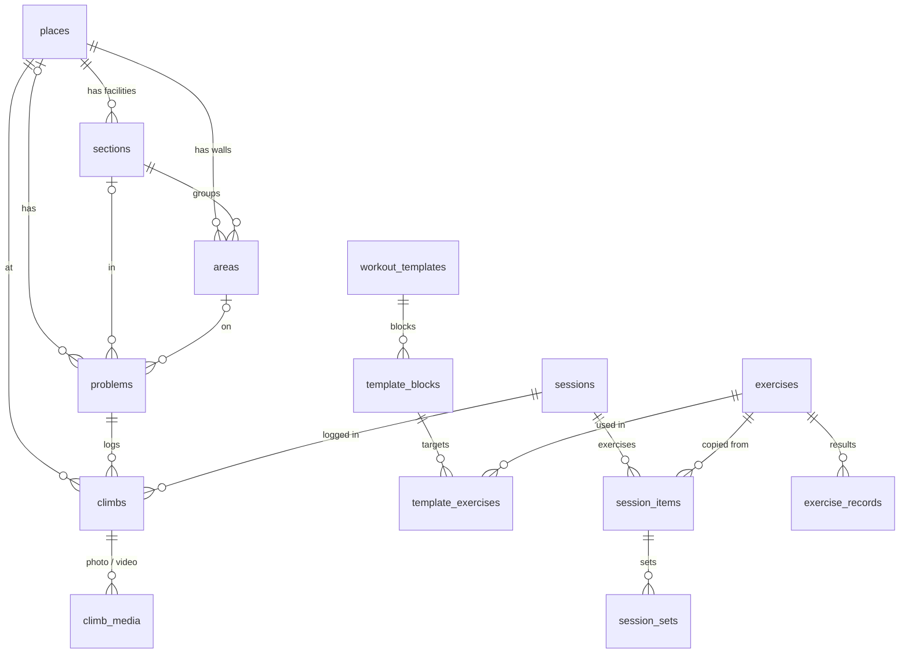

# Data model

Room database [`CruxDatabase`](../../app/src/main/java/com/hardtekpt/crux/data/local/CruxDatabase.kt),
**schema 29** at the time of writing. The exported schemas live in
[`app/schemas/`](../../app/schemas/com.hardtekpt.crux.data.local.CruxDatabase); each version's JSON
is the source of truth for its tables. To change the schema, see [Database](database.md).

## Entities

| Table | Holds | Key columns |
| --- | --- | --- |
| `climbs` | Logs: a day's goes on a climb | `problemId` (its climb; set on every log since schema 21), `discipline`, `gradeScale` + `gradeIndex` (+ `gradeLabel`/`gradeColour` for local grades), `style` (worked out from the goes), `attempts`, `sends`, `venue`, `dateEpochDay`, `name` (the climb's), optional `placeId`/`sectionId`/`areaId`, `effort`, `sessionId`; `angle` is unused since schema 22, which moved it into `notes` |
| `climb_media` | A climb's photo and video | `climbId`, `kind` (`IMAGE`/`VIDEO`), `path` (a file name in `files/area_images`) |
| `places` | Gyms, crags, boards | `name`, `type` (main kind), `extraTypes`, `favourite`, `latitude`/`longitude`/`address`, legacy place-wide scales |
| `sections` | A place's facilities | `placeId`, `type` (`GYM`/`CRAG`/`BOARD`), `name`, `position`, `boulderScale`/`routeScale`/`localScale`; board facilities (schema 26): `boardModel` (a `BoardModel.key`, null = custom board), `boardSize` (Kilter, `"12x12"`), `boardHolds` (Kilter Homewall, `full_ride`/`mainline`). A board's angle is never stored as a field: it is the first line of the log's `notes` (`BoardAngleNote`); schema 22 logs carry it as a last line, `Board angle 40°` |
| `areas` | Walls and boards | `placeId`, `sectionId`, `name`, `resetEpochDay` (legacy, unused), `imagePath`; `angle` is unused since schema 22, which added it to `name` |
| `problems` | Climbs: what's tried, by name and grade | optional `placeId`/`sectionId`/`areaId` (at a place, `sectionId` is always set since schema 23; `ClimbLinks` matches logs by place, facility and name). Name, discipline, grade and where belong to the climb: saving a log on a climb writes them to it (`ClimbLinks.adoptLog`) and every log keeps a copy in step (`ClimbLinks.syncLogs`, run on all logs by schema 24), `name`, `discipline`, grade, `tape`, `setEpochDay`, `retired` (legacy, unused); schema 28 adds `setter` and `sourceDatasetClimbId` (the dataset climb it was picked from, set null when that goes; name, grade and setter are copies) |
| `exercises` | The exercise library | `name`, `category`, `metric`, defaults (`defaultSets`…`defaultRepRestSeconds`, `prepSeconds`) |
| `workout_templates` | Session plans | `name`, `description`, `position` |
| `datasets` | Your lists of climbs to pick from (schema 27) | `name`, `kind` (`own`; `catalogue` comes with board catalogues), `boardModel` (a `BoardModel.key`, `custom` for a custom board, null for none), `boardSize`, `boardHolds`, `boulderScale`/`routeScale` (null = the climber's settings; never local), `createdAtMillis`, `updatedAtMillis` |
| `dataset_climbs` | Entries in a dataset, not climbs in the journal | `datasetId` (cascade), `name`, `discipline`, `gradeScale` + `gradeIndex` (both null when ungraded), `setter`, `note`, `createdAtMillis`. `DatasetFiles` reads and writes them as CSV and `.crux-dataset.json` (format `crux-dataset`, version 1) |
| `datasets` (schema 29) | Board catalogues | `kind` `catalogue`, `catalogueKey` (the catalogue database's key, `boardsesh:kilter:8:25`: layout and kept size), `climbCount`; their climbs are in the catalogue database below |
| `section_datasets` | Datasets linked to a facility by hand (schema 28) | `sectionId` + `datasetId` (both cascade). A facility also uses every dataset made for its board (`Dataset.fitsBoard`: same model, and a Kilter's size and Homewall's holds), which needs no row; `datasetsFor` puts the two together |
| `playlists` | Ordered picks of dataset climbs (schema 28) | `name`, `note`, `createdAtMillis`, `updatedAtMillis` |
| `playlist_items` | A playlist's climbs | `playlistId` (cascade), `position`, `datasetClimbId` (cascade; null for an imported climb not matched yet), copies of `datasetName`, `name`, `discipline`, `gradeScale`/`gradeIndex` for matching. `PlaylistFiles` writes `.crux-playlist.json` (format `crux-playlist`, version 1) |
| `schedule_slots` | The weekly schedule (schema 25), repeating every week | `dayOfWeek` (1 Monday to 7 Sunday), `position`, `kind` (`PLAN`/`CLIMB`), `templateId` (cascade), `placeId` (set null); a day with none is rest |
| `template_blocks` | A plan's blocks | `templateId`, `position`, `name` |
| `template_exercises` | An exercise's target in a block | `blockId`, `exerciseId`, `sets`, `reps`, `seconds`, `loadKg`, `restSeconds`, `repRestSeconds` |
| `sessions` | Live and finished sessions | `templateId`, `placeId`, `sectionId`, `startedAtMillis`, `endedAtMillis`, `status` (`RUNNING`/`FINISHED`/`DISCARDED`), `effort`, `notes`; schema 28: `playlistId` and `playlistIndex`, the playlist being climbed and the climb that's up |
| `session_items` | A session's exercises (copied from the plan) | `sessionId`, `exerciseId`, `blockName`, target columns |
| `session_sets` | What was done | `itemId`, `setIndex`, `reps`, `seconds`, `loadKg`, `skipped`, `completedAtMillis` |
| `body_measurements` | Weight, body stats, circumferences | `type` (`MeasurementType`), `value` (kg/cm), `dateEpochDay` |
| `exercise_records` | Results for personal records | `exerciseId`, `dateEpochDay`, `reps`, `seconds`, `loadKg`, `notes` |
| `notes` | Free notes | `text`, `pinned`, `tag` (lower case) |

Schema 29 also adds `problems.sourceCatalogueUuid` (a board catalogue climb it was picked from,
by the board's id, which a re-import keeps) and `playlist_items.catalogueUuid`.

## The catalogue database

Board catalogues live in a second Room database, `crux-catalogue.db`
([`CatalogueDatabase`](../../app/src/main/java/com/hardtekpt/crux/data/Catalogue.kt)), shared by
your data and the demo, never migrated (it is rebuilt on a schema change and imported again),
never backed up or exported.

| Table | Holds | Key columns |
| --- | --- | --- |
| `catalogue_climbs` | A catalogue's climbs | `catalogueKey` + `uuid` (the board's climb id), `name`, `setter`, `description`, `frames` (the board's hold string, for hold diagrams), `setterAngle`, `createdAt` |
| `catalogue_grades` | A climb at each angle | `catalogueKey` + `uuid` + `angle`, `difficulty` (the board's number: 16 is 6a/V3, 22 is 7a/V6; `BoardseshBoards.fontIndex` reads it as Font), `benchmark`, `ascents`, `quality` |

`CatalogueImporter` reads a Boardsesh snapshot (SQLite, gzipped or not; `board_climbs` and
`board_climb_stats`, shape 1 or 2) with Android's own SQLite, keeps listed climbs whose
`compatible_size_ids` include the chosen size (`BoardseshBoards.sizeIds`), and copies them in
batches. `BoardseshBoards` maps Boardsesh's (board type, layout) pairs to `BoardModel`s.

## Conventions

- **Dates** are `dateEpochDay` (local days). **Instants** are `…AtMillis`.
- **Units** are always metric (kg, cm). Imperial is display-only.
- **Enums** are stored by name. Renaming an enum entry needs a data migration.
- **Grades** are scale + index, plus label and colour for local grades. They're never converted.
- **Derived data isn't stored**: projects, personal bests, personal records, streaks and climb
  stats are computed in SQL or in repositories from the rows above.
- **Media** rows store file names only. The files live in `files/area_images`.

## Other storage

| Where | What |
| --- | --- |
| DataStore `files/datastore/user_prefs.preferences_pb` | Grade scales, theme, units, timer, demo mode, demo data version, Home dashboard layout (JSON), backup photo and video switches |
| `files/area_images/` | Photos (JPEG, at most 2048 px) and videos |
| `files/crashes/` | Crash reports (newest 10) |
| `files/db-backups/` | Copies of `crux-user.db` taken before migrations (newest 3) |
| `databases/crux.db` | The demo database (same schema) |
