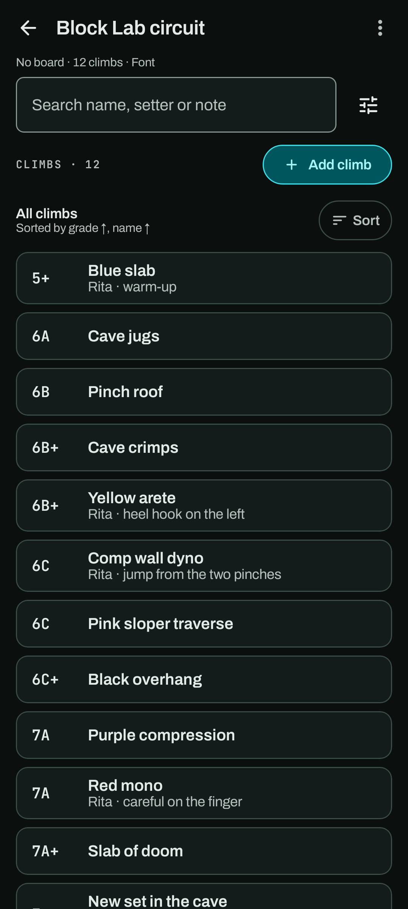
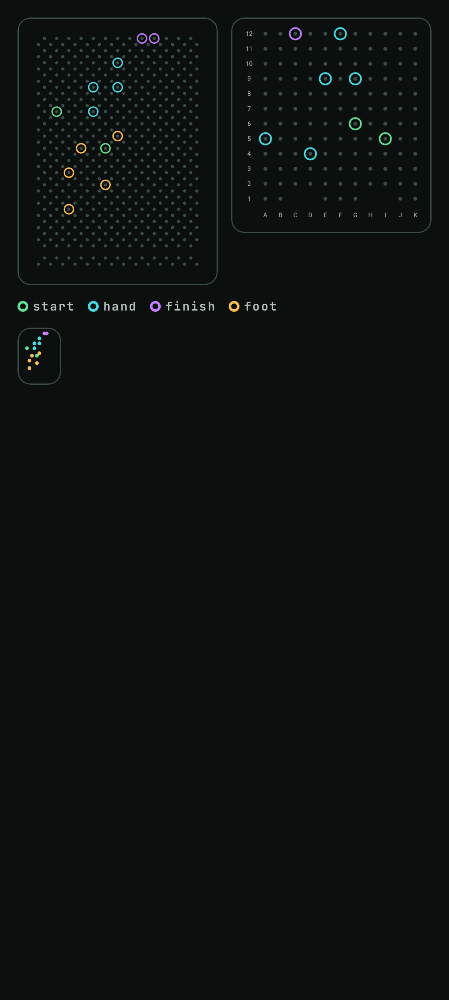
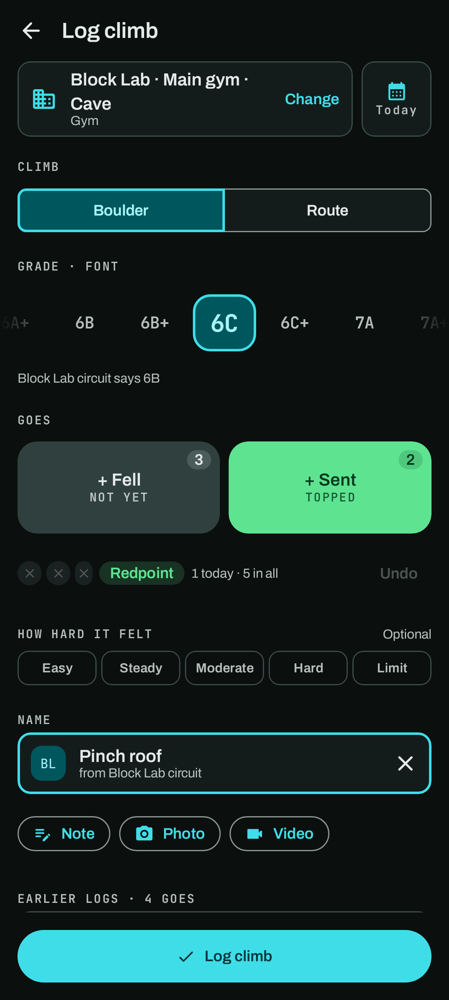
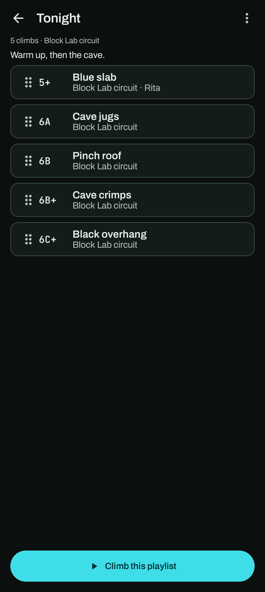
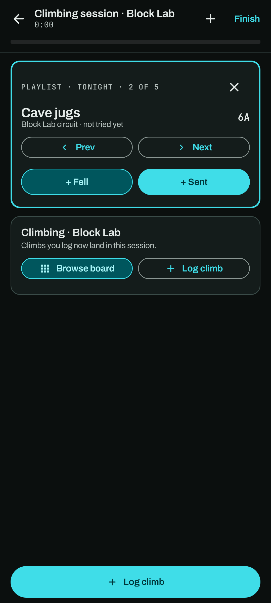

# Datasets

A **dataset** is a list of climbs you keep to pick from: your home board's problems, a spray wall,
a gym circuit or a crag's lines. Find them under **You → Datasets**, under Places, with your
**playlists** in the second tab. When you log a climb at a facility that uses a dataset, you can
pick the climb from it instead of typing it.

A dataset climb is not a climb in your journal: it's an entry in a list. Nothing in the Journal,
Progress or Places changes when you add, change or delete one.

## Making a dataset

Tap **+ → New dataset** (or **New dataset** on the empty page):

- **Name**, such as "Garage board" or "Block Lab circuit".
- **Board** (optional): one of the boards a place can have (Kilter, MoonBoard), **Custom board**
  for a spray wall or home board, or **No board** for a gym or crag list. A Kilter board asks for
  its size.
- **Boulder grades** and **Route grades**: the scales its climbs are graded in, or My settings.

**⋯ → Edit details** changes them later.

## Climbs in a dataset

**Add climb** (beside the list, above the climbs) opens a sheet: the name, Boulder or Route, the grade strip (or **No grade**), the
setter and a note. A name already in the dataset shows "Already in this dataset" but is allowed,
since gyms reuse names. Tap a climb to change it or delete it; a climb without a note goes at once
with **Undo**, and one with a note asks first.

Search finds a word in the name, setter or note. Under it, the [filter bar](#filters-and-sorts)
sorts and filters the list (by grade, by what you've done, by setter), as on a board catalogue; the
filters button beside the search opens Filters.

**⋯ → Delete dataset** asks first. Its climbs go with it; climbs you logged are never touched.

## Import and export

**+ → Import a file** (or **⋯ → Import climbs** in a dataset) reads:

- **CSV**: UTF-8, comma or semicolon separated, with a header row. The columns are `name`,
  `grade`, `type` (boulder or route; boulder if left out), `setter` and `note`, in any order and
  any case. Only `name` is needed; rows without one are left out and counted, and other columns
  are listed and ignored.
- **Climb Logger dataset file** (`.crux-dataset.json`), as Climb Logger exports it, with the board and scales.

Before anything is saved, a preview shows how many climbs the file has, which grades aren't
recognised, where they go (a new dataset, or one you have) and the first rows. Grades are read in
the dataset's scales; change the scale there to read them again. A grade that isn't one of the
scale's keeps the climb without a grade and adds "Grade in file: …" to its note, so nothing is
lost. When climbs go into a dataset that already has one of the same name and type, pick **Skip**,
**Replace** or **Keep both**.

**⋯ → Export** saves the dataset as a CSV (the same five columns) or a Climb Logger dataset file, through
Android's save dialog. Climb Logger needs no storage permission for either.

Datasets and playlists are in your backups (the **Datasets** switch, on by default).

## Board catalogues

A **board catalogue** is a board's whole list of climbs, for a Kilter (Original or Homewall) or a
MoonBoard (2016, 2017, 2019, 2024, Mini 2020 or Mini 2025). Climb Logger reads the snapshot files
[Boardsesh](https://boardsesh.com) publishes: download the one for your board (a `.db` or `.db.gz`
file) and pick it in **+ → Import a file**. Climb Logger never goes online for it.

- Climb Logger reads which board the file is. A Kilter asks your board's size (and a Homewall's holds),
  starting at your board facility's, and keeps only the climbs for it; a Kilter Original file holds
  every size, so this cuts it down a lot. A big file takes a while: you can leave the page and the
  import carries on.
- Catalogues sit in their own section on the Datasets page, marked read-only. They're kept apart
  from your data: they aren't in backups or exports. Climbs you logged from one remember which it
  was, so importing it again links them back.
- Open one to browse its climbs at an angle (a Kilter's grades and ascents change with the
  angle; a MoonBoard has its one or two). Search names and setters, and narrow and order the list
  with [filters and sorts](#filters-and-sorts); **Tune** in the top bar shows every filter at once.
  Grades show in your boulder scale, and each climb shows your goes on it.
- Tap a climb for its setter, description and grade at each angle, **Log this climb** and
  **Playlist**.
- A catalogue is used by every facility with the same board and size, like a dataset made for it.
  In Log climb's Climb step its chip searches it, most sent first, at the angle on the Angle chip;
  picking a climb grades it at that angle ("Kilter Homewall says 6C at 40°"), and changing the
  angle follows. Typing a name suggests its climbs too.
- The **bin** in the top bar deletes it (it asks first); import it again any time.

### Filters and sorts

Board catalogues, your datasets and **Browse a board** in a session show one compact line under
the search: what's applied ("40° · 6C–7A · Not sent", or "All climbs at 40°") and how the list is
sorted. Tap the line (or **Tune**) for **Filters**, and **Sort** beside it for the order. Filters
add up: a climb shows only when it matches all of them. **Clear** beside the count, or **Clear
all** in Filters, puts them back (the angle stays).

| In Filters | What it does |
|---|---|
| Angle | Catalogues only: the angle, as segments. |
| Grade | Opens a grid of the grades with a bar for how many climbs each has: tap the easiest, then the hardest. **Near my max** (your hardest send here, one grade either way), **Warm-up** and **Below my max** follow your sends. **Back to filters** returns. |
| You | **New**, **Tried** and **Sent**, any of them; New and Tried together read **Not sent**. |
| Rating | Catalogues only: Any, 2+, 2.5+ or 3+, the board's rating at this angle. |
| Ascents | Catalogues only: Any, 10+, 50+ or 200+. |
| Setter | Opens a search of the setters with climbs here; tick any number. |
| Sort | Opens the sort, as **Sort** does. |
| Benchmarks only | Catalogues only. |

**Sort** chains up to three sorts, each with a direction: the first decides and the next breaks its
ties. Tap a line's arrow to turn it round, hold its handle and drag to reorder, and **Then by**
adds Grade, Popular, Rating, Your goes, Newest, Name or Setter. **Default** goes back to Popular,
then Grade (Grade, then Name for a dataset).

**Views** save the whole set, sorts included, under a name: **Save as view** in Filters. Tap a view
to use it, hold it to delete it. Each board and dataset remembers its last filters and sort.

A MoonBoard's grades always read in Font, as the MoonBoard grades them; a Kilter's follow your
boulder scale.

### Hold diagrams

A board catalogue's climbs show their holds on the board, drawn by Climb Logger: every hold of your
board as a faint dot, the climb's as rings, green for start, cyan for hand, violet for finish and
amber for foot (a legend says which). A MoonBoard shows its grid with the letters and numbers along
the edges. Tap a diagram for the whole board.

The diagram shows on the catalogue's climb sheet, as a thumbnail in Log climb's linked name row,
on the session's playlist card, and in Log climb for a board climb you logged before. Logging a
catalogue climb copies its holds onto your climb, so its diagram stays even after you delete the
catalogue. The hold positions are built into Climb Logger (positions only, no climbs or board images).

Climbs and grades come from each board's community. Climb Logger isn't affiliated with Kilter or Moon
Climbing, and never shows their board images.

## Lighting your board

Climb Logger can light a catalogue climb's holds on your own Kilter or MoonBoard over Bluetooth. It
never lights anything by itself: a **Light** button sends the climb you're looking at.

- **Pair once.** In **Edit place**, a Kilter or MoonBoard facility has a **Lights** row. **Pair a
  board** opens Android's own device list (a Kilter shows only Kilter boards); pick yours. Climb Logger asks
  once for **Nearby devices** on Android 12 and up, and never for your location. The pairing stays
  on this phone and isn't in backups.
- **Test lights** lights the four corners of your size. On a MoonBoard, **Check a hold** lights one
  corner and asks which one lit, so Climb Logger counts your box's LEDs the right way round. **Lights off**
  and **Forget** do what they say.
- **Light** shows on the catalogue climb sheet, under the linked name in Log climb and on the
  session's playlist card, whenever a paired board of that model and size can take the climb (the
  facility you're at first). Lit, it says where, with **Off**. A climb for a bigger Kilter size
  doesn't offer it.
- **In a session**, the live notification of a playlist has **Prev**, **Next** and **Light**, so
  you can move on and send the next climb from the mat.
- If the board can't be reached, Climb Logger says so ("Is it on and close by?") and nothing else waits on
  it.

Kilter boards speak Aurora's protocol 2 or 3, read from the board's name; MoonBoard LED boxes take
the newer Nordic module or the first-generation one.

## Open in MoonBoard

A MoonBoard catalogue climb's sheet has **Open in MoonBoard** when the official MoonBoard app is
on your phone. It copies the climb's name and opens the app, so you can paste it into the app's
search. The MoonBoard app can't be sent straight to one problem: it opens no problem from a link.

## Where a dataset is offered

A facility uses:

- every dataset made for its board: the same model and, for a Kilter, the same size (and a
  Homewall's holds). Nothing to set up: a "Kilter warm-ups" list works at every Kilter of that size.
- any dataset you link to it by hand, such as a gym circuit on the main gym or a list for your
  custom board. In **Edit place**, each facility has a **Datasets** row: tick the datasets to use
  there. Those made for its board are ticked and locked ("Same board"). **New dataset for this
  board** makes one with the facility's board and grades.

## Picking a climb when you log

At a facility that uses datasets, the **Where** sheet in Log climb gets a last step, **Climb**
(after the wall, at a gym). It lists your climbs there first, then a chip for each playlist and
dataset, with a search. Rows show the grade in the facility's scale and how you've done on the
climb here (sent, a project, or never logged). Done without picking works as before, and **New
climb** leaves the name for you to type.

Picking a climb fills in Boulder or Route, its grade (converted to the facility's scale) and its
name, which becomes a linked row: the dataset's badge, "from Garage board · set by Ana", and ✕ to
make it a plain name again. A line under the grade strip says the dataset's own grade, such as
"Garage board says V6". If you already have a climb of that name here, picking it continues that
climb, and opens its log when you climbed it today.

Typing in the Name field also suggests up to three climbs from the facility's datasets.

In a dataset, tap a climb and **Log this climb**: Where is filled in when one facility uses the
dataset, and the Where sheet opens on them when several do.

The climb you log is a normal Climb Logger climb: it copies the name, grade and setter. Changing or
deleting the dataset later never changes your climbs or logs; a deleted dataset climb just stops
showing as linked.

## Playlists

A **playlist** is an ordered pick of climbs from your datasets, like "Tonight" or "7A benchmarks".

- Make one from **+ → New playlist**, or while adding climbs. In a dataset, long-press climbs to
  select several, then **Add to playlist**; or tap one climb and **Playlist**.
- In a playlist, hold a climb's handle and drag it to move it, and swipe it away to remove it (with
  Undo). A dot marks climbs you tried today, green once sent. Tap a climb to log it.
- **⋯** holds Rename, Duplicate, Export (a `.crux-playlist.json` file to share) and Delete.
  **+ → Import a file** reads a playlist file too: each climb is found again by its dataset and
  name, and one whose dataset you don't have waits, greyed, until it's there.
- A climb deleted from its dataset leaves your playlists too.

**Climb this playlist** starts a session (at a facility that uses its datasets) or joins the one
running. You can also start one from a session's **+ → Climb a playlist**.

The session shows a playlist card: the climb that's up, its grade and how it's gone today, **Prev**
and **Next**, and **+ Fell** and **+ Sent**, which add a go to it straight away (with Undo for a
few seconds). Tap the climb to open Log climb on it; ✕ stops the playlist.
