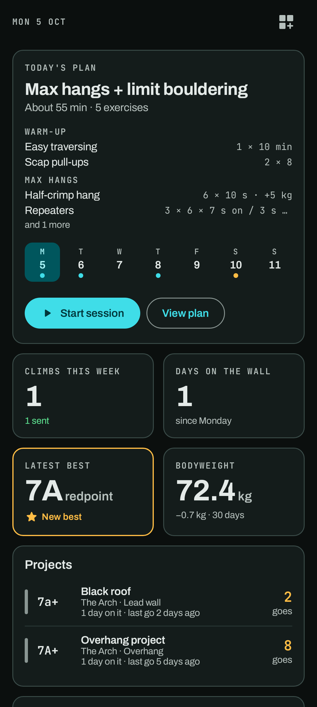

# Home

Home is a dashboard of widgets that you choose and arrange yourself.

Home has no title bar: the dashboard starts with the date, and the button at its end edits the
dashboard. While editing, a bar at the top holds *Add widget* and *Done*.

## Widgets

| Widget | Shows |
| --- | --- |
| **Today's plan** | Today's plan from your week (*Train → Week*), with how long it takes, each block with its exercises and what they ask for (wide shows the first four, large all of them), *Start session* and *View plan*, and the week as a strip of days with their dates and dots: teal for plans, amber for climbing, green once done. On a rest day it says what's next. With no week set up, it rotates through your plans by day of the week. |
| **This week** | Climbs and sends since Monday. Tap it for the **Climbs this week** page: the week's climbs, sends, days and hardest send, then each day's climbs (sessions included) as the Journal shows them. The arrows go back through earlier weeks. |
| **Days on the wall** | Days you climbed since Monday. Tap it for the **Days on the wall** page: your days this week, month and year and your week streak, and a month calendar with each climbing day filled (deeper for more climbs). Tap a day to see its journal under the calendar; the arrows page through the months. |
| **Latest best** | Your newest hardest send: the latest send harder than every send before it, in any style. An easier flash after a harder redpoint doesn't replace it. Grades are compared within a scale. |
| **Bodyweight** | Your latest weigh-in and the change over 30 days. Tap it to open Measurements. |
| **Weight trend** | A chart of your weigh-ins. Tap it to open Measurements. |
| **Sends per week** | A chart of sends over recent weeks. |
| **Sends by style** | Flash, onsight and redpoint, side by side. |
| **Recent climbs** | Your last few climbs. Tap one to log it: that opens today's log of it to add goes to, or a new log if you haven't tried it today. |
| **Projects** | Climbs you've tried but not sent yet, with how many goes and when you last tried. Tap one to open it. |
| **Training** | A training figure you choose when you add it: **On plan** (sessions and climbing days done against your Week schedule), **Sessions**, **Sets**, **Time trained** or **New bests**. Small, it shows this week (On plan as a ring); wide or large, a chart of the last weeks. Tap it to open Progress. |
| **Exercise** | An exercise you choose when you add it. Small, your best on it; wide or large, your best set each day over 3 months or a year. Tap it to open the exercise's page. |
| **Consistency** | The consistency grid from the You page: a square per day you climbed over the last weeks, with your week streak and days in the last 30. Large, it shows your streak, best streak and last 30 days as three figures. Tap it to open You. |

## Arranging the dashboard

Tap the grid icon beside the date to start editing. Then:

- **Remove** a widget with its ✕.
- **Resize** it. Most widgets come in small (half width), wide or large.
- **Move** it by dragging its handle. Small widgets pair up in a row.
- **Add** one from the catalogue with *Add widget*. **Training** and **Exercise** then ask what to show.
- **Change what it shows** with the tune button on a Training or Exercise widget.

Tap *Done* to save. *Reset layout* brings back the default dashboard.

The dashboard layout is a display setting: each data set (yours and demo) shows the same layout.
Backups carry it with your other settings.
