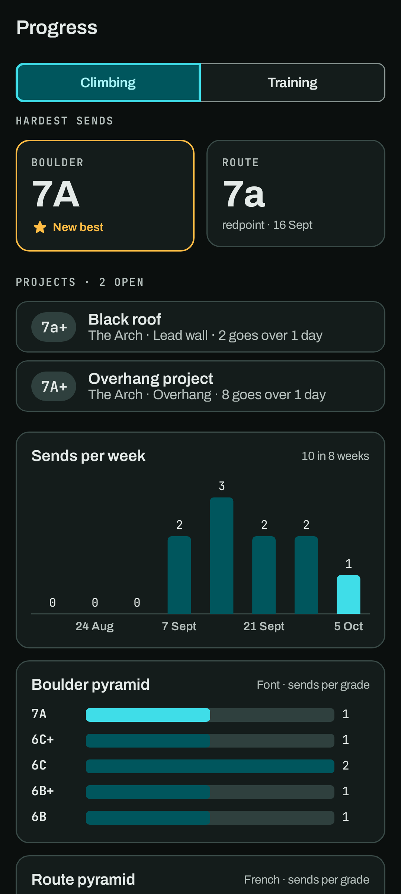
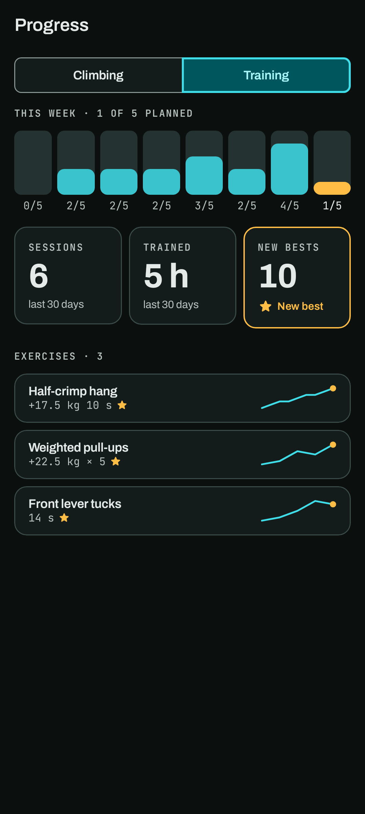
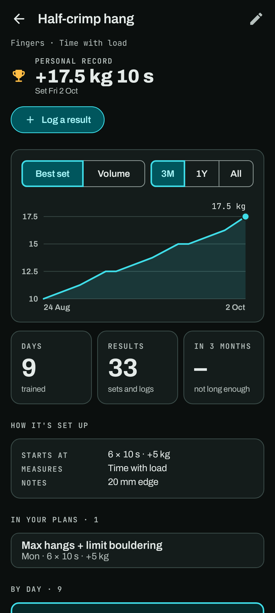

# Progress

Progress shows how your climbing and your training are going, worked out from what you've
already logged. There's nothing to fill in here. It has two tabs, **Climbing** and **Training**;
tap one or swipe sideways to switch.

## Climbing

### Hardest sends

Your hardest send for each discipline (bouldering, routes) **in each grade scale** you've climbed
in, and the hardest per style (flash, onsight, redpoint). Grades in different scales are never
compared with each other, so a Font best and a V best sit side by side.

Local grades (a gym's own numbers or colour tapes) are kept per place, in that place's own order.

### Charts

- **Grade pyramid** per discipline: how many sends at each grade.
- **Sends per week**.
- **Sends by style**.

### Projects

The climbs you've tried and not sent yet, most recently tried first, with how many goes and
where. Tap one to log more goes on it (it opens today's log of the climb, or a new log if there isn't one), or tap **+1 go** to log a fall. See [Places → Projects](places.md#projects).

## Training

- **This week**, then a bar for each of the last 8 weeks. With a [Week schedule](training.md), each
  bar fills by how much of it you did: a finished session counts for each plan on the schedule,
  and a day with climbs for each climbing day. Without one, the bars count sessions. This week is
  in amber.
- **Sessions**, **Trained** (time in sessions) and **New bests** over the last 30 days. A new best
  is a result that beats every earlier one on its exercise.
- **Exercises**: every exercise you've done, most recently trained first, with your best and a
  small trend of your best set each day. A star marks a best set in the last two weeks.

Sets done in sessions and results logged by hand both count.

### An exercise's page

Every exercise has one page, whichever list you open it from: *Train → Exercises*, *You → Personal
records*, Progress → Training, the Home **Exercise** widget, an exercise in a plan, **About this
exercise** in a session's ⋯ menu, or a result in the Journal. It holds:

- The exercise's category and what it measures, and the **pencil** to edit it (name, category,
  defaults, interval timer, delete).
- Your **personal record**, **Log a result**, and for interval exercises **Timer**, which opens the
  Interval timer set from the exercise.
- The chart below, with three figures: days trained, results, and how much your best moved in the
  last 3 months.
- **How it's set up**: what plans and sessions start it at, what it measures, and its notes.
- **In your plans**: each plan that uses it, the days it's on and its target there. Tap one to open
  the plan.
- **By day**, below.

- **Best set**: your best set each day, by the load where load counts, else the time held, else
  the reps. **Volume**: sets per week, or per month over a year or more.
- **3M**, **1Y** or **All** for the time window.
- **By day**: how many sets (or results logged by hand) that day, and the best of them. The trophy
  marks your record. A day with one result logged by hand can be deleted here; sets from a session
  are changed in their session.
