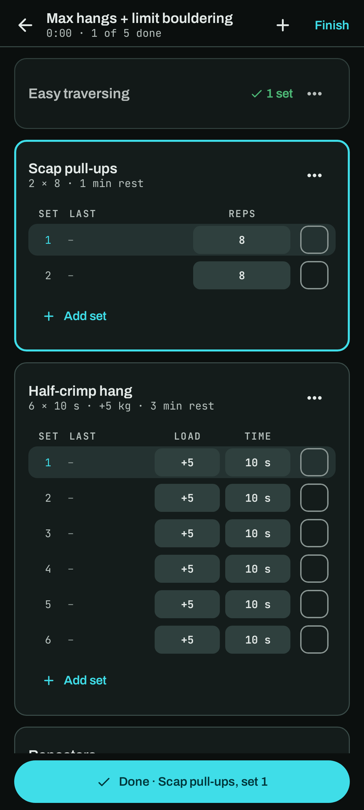

# Sessions

A session is a workout you log as you go: either one of your plans, set by set, or a climbing day
without a plan, where you log climbs.

## Starting a session

- From the **+** Log menu, choose **Start a session**, then pick a plan or *no plan* for a
  climbing day.
- From a plan's page, or the **Today's plan** widget on Home, tap **Start session**.

Crux starts the session at the last place you climbed, and you can change that inside the
session. Only one session runs at a time; starting another ends the first.

## While it runs

- The top bar shows the session's name, a quiet clock with how many exercises are done, **+** and
  **Finish**.
- **The rail** under it has a segment per exercise that fills as its sets go in and turns green
  once it's done. Tap a segment to scroll to that exercise.
- **Every exercise in one list**, in plan order. Each card shows the target (for example
  "6 × 10 s · +17.5 kg · 3 min rest") and a table of its sets: the set number, what you did last
  time, the values (load, reps, time) and a tick box. The exercise with the next set is outlined in
  the accent colour (in the timer's colour while its timer runs), and its next set is highlighted.
  Once every set is in, the card folds to one line with a green tick ("✓ 3 sets"); tap its name to
  open or fold it.
- **Logging a set**: each set starts at the target, or at what your last set was. Tap a value to
  change it with a stepper right under the row, then tick the box. Change a set you already ticked
  the same way; tick it again to take it back. **Add set** adds one more for this session.
- **The dock** at the bottom always shows what's next: **Done · Exercise, set N** ticks the next
  set, **Start timer** runs the next interval exercise, and **Log climb** on a climbing day.
- **The ⋯ menu** on an exercise opens **About this exercise** (its page, with your record and
  chart), changes its sets, reps or time, load and rest, starts its timer, skips the rest of it, or
  takes it out while nothing is logged on it. A change is for this session only, unless you switch
  on **Also change the plan**: then the plan changes too, so next time starts from it.
- **Rest timer**: after a set, the dock turns amber with the rest counting down, what's next, a bar
  that drains as it runs out, **+30 s** and **Skip**. It beeps for the last three seconds and
  buzzes when the rest is over.
- **Interval timer**: interval exercises run a timer in the dock: the time left in the phase, the
  phase with its rep and cycle ("Work · rep 3 of 6 · cycle 2 of 3"), the cycle's repeats as dots,
  pause and next phase (stop once paused). The dock fills with the work colour while you work and
  is tinted for rests. Each finished cycle is logged as a set. You can also tick cycles by hand.
- **Big timer**: tap the dock and the rest or timer fills the top of the screen with one big
  number, for when your phone is on the floor across the mat. A big rest has **−30 s**, **+30 s**
  and **Skip rest**; a big timer has back, pause, next and stop. **Make small** puts it back in
  the dock. It stays big for the next rest until you make it small.
- **+ in the top bar**: log a climb, add an exercise from your library, or run an interval timer of
  its own. Presets include classic Tabata (8 × 20 s on, 10 s off) and hangboard repeaters
  (6 × 7 s on, 3 s off, three cycles, 3 min between). Outside a session, *You → Interval timer* is
  a full-screen timer of its own: see [You](you.md#interval-timer).
- **Climbs**: a climb logged inside a session goes into the session and your journal, and shows on
  the session's **Climbs** card under the exercises, outlined in amber, with your hardest send and
  **Log climb** on it. Each climb shows its grade, how it went and **+ go** to log another go. On a
  climbing day three tiles on top show your climbs, sends and hardest send so far. Several logs on the same climb show
  as one entry with the goes added up (a redpoint once one of them is a send), here, in the
  Journal and in the session's summary. Tap a climb in the session to log more goes on it. If
  **Rest after a climb** is set in Settings, logging a
  climb starts that rest in the dock, so you know when to pull on again.

The screen stays on while something counts down. Timers are worked out from the clock, so they stay
right if the screen turns off or you switch apps.

**Leaving** with the back arrow keeps the session running. A pill above the bottom bar shows its
name and clock; tap it to go back.

## Live notification

While a session runs, Crux keeps a live notification, so you can see where you are and act without
opening the app. On Android 16 it is a Live Update: a bar in segments and a chip in the status bar.
On Android 8 to 15 it is a plain notification with a progress bar. Tap the card to go back to the
session or timer; there is no Open button.

- **A session with a plan**: one segment per exercise, green once it's done. The title reads
  "Exercise · set N of M". **Set done** logs the next set as planned and starts its rest.
- **Resting**: the card turns into the countdown, in amber, with **+30 s**, **−30 s** and
  **Skip rest**. The time left leads the title ("1:24 · Rest") and fills the status bar chip. When the rest ends the phone buzzes, if *Timer sounds* is on in Settings.
- **The interval timer**: the time left in the current phase leads the title ("0:14 · Work") and
  fills the status bar chip; below it, the rep and cycle. The bar shows the current cycle rep by
  rep, teal for work and amber for rest. Finished
  cycles are green, and the rests between cycles are violet. **Pause** (then **Resume**) and
  **Stop** are on the card. The *You → Interval timer* page shows the same card.
- **A climbing day with no plan**: the time on the wall, with a mark for each climb (green for a
  send, grey for not yet). The title reads "N climbs · M sent" and **Log climb** is on the card.

On Android 13 and later, Crux asks for permission to show notifications the first time a session
starts. If you say no, you just don't get the notification; everything else works as before.

## Finishing

Tap **Finish**. Add how hard it felt (1–10) and a note, then save. Or throw the session away. Crux
asks first, and climbs you logged in it stay in the journal.

Finished sessions appear in the [Journal](journal.md) with their length. Tap one for its
summary: when, where and for how long, how it felt, what got done against the plan, every set of
every exercise, the climbs and your note. The **pencil** edits it: its day, when it started and
finished (a finish before the start means it ran past midnight), how hard it felt, and the note.

Session history is in backups, with every set, and the climbs logged in a session stay linked to it
when you restore.
