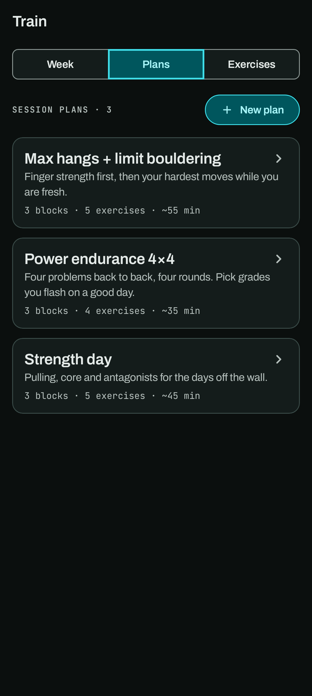
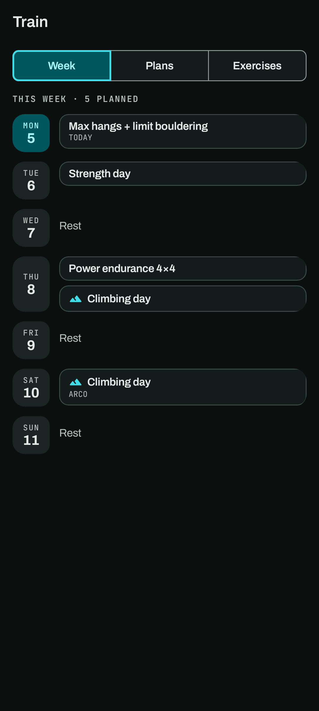

# Training: your week, exercises and plans

The **Train** tab has three parts: **Week** (your weekly schedule), **Plans** (your session plans)
and **Exercises** (your exercise library). Swipe sideways or tap the segment at the top to switch.

If both lists are empty, *Add starter exercises and plans* copies in a starter library: a few
classic finger, pulling, core and on-the-wall exercises and three plans built from them. They're
yours to change or delete.

## Week

Your week, Monday to Sunday, and it repeats every week. Tap a day to set it: tick any of your
plans, and turn on **Climbing day** (with a place if you like). A day with nothing is a rest day.
Today's tile is in the accent. A plan turns green with its time once you finish a session of it
that day, and a climbing day once you log a climb.

Home's **Today's plan** follows the week. Deleting a plan takes it off the week.

## Exercises

An exercise has:

- **Name** and optional **Notes**.
- **Category**: Fingers, Pulling, Core, On the wall, Antagonist, Mobility or Other.
- **Measured by**, which decides what you log for it:

  | Measured by | You log | Example |
  | --- | --- | --- |
  | Reps | Repetitions | Scap pull-ups |
  | Reps with load | Repetitions and added load | Weighted pull-ups |
  | Time | A duration | Front lever hold |
  | Time with load | A duration and added load | Max hangs |
  | Intervals | Timed work and rest, repeated in cycles | Tabata, circuits |
  | Intervals with load | The same, with added load | Weighted repeaters |

- **Defaults**: the sets, reps or time, rest between sets and added load a plan or session starts
  the exercise at. Negative load means assistance (a pulley or band). Interval exercises set up
  their **interval timer** here instead: preparation, work, rest between repeats, repeats per
  cycle, cycles and rest between cycles.

The exercise list shows each exercise's defaults under its name, like "5 × 5 · +10 kg · 3 min rest",
with its note after them. Once you've trained one, it shows your best instead, with a small trend.
Tap an exercise for [its page](progress.md#an-exercises-page): your record, chart, how it's set up,
the plans that use it and every day you trained it. The pencil there edits it. **New exercise**
opens the editor straight away, and saving lands on the new exercise's page.

Deleting an exercise that plans use first tells you how many plans would lose it.

## Plans

A plan is a named, ordered list of **blocks** (for example *Warm-up*, *Main*, *Cool-down*), each
holding exercises with a **target**: what you're aiming for in that plan.

To build one, tap **New plan**, give it a name and optional description, then:

1. **Add block** for each part of the session, and name it.
2. **Add exercise** to a block, search the library, and pick one.
3. Adjust the target in the sheet that opens: sets, reps or time, load, rest, and for intervals the
   timer. Each value is a wheel or stepper you can drag, step, or tap to type.
4. **Save plan**.

The plan's card shows its blocks, exercise count and an estimated length (work and rest plus a
short changeover between exercises, rounded up to 5 minutes).

Open a plan to see every block and target, and tap **Start session** to run it. See
[Sessions](sessions.md).

## Personal records

Log a result on any exercise from *You → Personal records → Log a record*. The best result is the
personal record: the heaviest load, then the most reps, or the longest hold for timed exercises.
See [You](you.md#personal-records).
